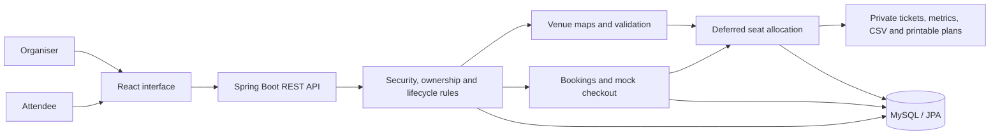

# Tixora — Event Management & Seating

**From an organiser's first draft to an attendee's assigned seat.**

[**Open the live application →**](https://tixora-live.onrender.com/) · [My contribution](#my-contribution--ryoji-kondo) · [Run the full application](#run-the-full-application) · [Verification](#verification)

Tixora is a University of Sydney team project built with **Java 17, Spring Boot, React and MySQL**. It connects event discovery, owner-managed publishing, simulated checkout and deferred group seating in one workflow.

My work focused on the rules behind that experience: **who can change an event, when it can be published, which venue data is valid, and whether bookings and seating survive transactions correctly.**

## Try the live application

[**Open Tixora →**](https://tixora-live.onrender.com/)

This deployment runs the **original React interface and real Spring Boot API**.
Data is retained in a dedicated **TiDB Cloud Starter database (MySQL-compatible)**,
using the existing MySQL JDBC driver and JPA model. It is not a browser simulation.
The university version uses MySQL; this free personal deployment uses TiDB, and
that hosting difference is explicit.

Render's free server sleeps when inactive. The first request can take a minute or
more to wake it; leave the page open while it starts. Allow around 1–2 minutes
on a cold start. Both demo accounts and passwords are also displayed directly
on the [login screen](https://tixora-live.onrender.com/auth).

| Workspace | Fictional demo login | Password |
| --- | --- | --- |
| Organiser | `committee.demo@uni.sydney.edu.au` | `OrganiserDemo1!` |
| Attendee | `attendee.demo@uni.sydney.edu.au` | `TixoraDemo3!` |

1. Sign in as the organiser, open **Organiser dashboard**, and create an event with a future date.
2. Configure a venue, save the draft and publish it. Venue maps are illustrative
   software fixtures, not verified physical seating plans.
3. Sign out and sign in as the attendee. Book the event with a simulated checkout.
4. Return as organiser, close registration and run allocation.
5. Return as attendee to view the private ticket and highlighted assigned seat.

Shared demo accounts and their fictional records can be changed by other visitors.
Use fictional data only. No real money is charged. Your own student test account
can also be created through the existing registration form.

## Live deployment verification — 12 November 2026

Verified against the public React + Spring Boot + TiDB deployment:

- Organiser and attendee login through the real authentication API.
- An event retained across a service redeployment, with saved venue data read back through the real API.
- Three complete journeys: FRONT assigned seating, general admission, and an Everest campus template.
- Draft creation, venue save, publication, mock checkout, deferred assignment, registration closure and successful-checkout retry after closure.
- Final tickets, anonymous CSV and printable HTML; no attendee emails in either export and no reusable group join code in the printable plan.
- Direct page links load correctly; unauthenticated access to the private bookings API returns HTTP 401.

Personal-hosting regression checks: **5 backend tests passed**, including row-lock SQL generation and closure/checkout concurrency; **95 frontend tests passed** and the production build succeeded. These checks complement the dated team baseline below. TiDB 8.5.3 requires a [hosting-specific dialect](app/src/main/java/com/ooaf/eventticketing/config/PublicTiDBDialect.java) that preserves `FOR UPDATE` locking while omitting its unsupported alias clause.

## My contribution — Ryoji Kondo

This is a five-person team project. The table distinguishes my implementation and verification from the system as a whole.

| My responsibility | What I implemented or verified | Code / evidence |
| --- | --- | --- |
| Event ownership and lifecycle | Derive ownership from the authenticated organiser; restrict editing and status changes; separate draft creation from publication and closure | [EventService](app/src/main/java/com/ooaf/eventticketing/service/EventService.java), [OrganiserEventController](app/src/main/java/com/ooaf/eventticketing/controller/OrganiserEventController.java) |
| Publication and public access rules | Reject invalid venue/capacity data; limit public discovery and likes to published events; validate seating prerequisites | [EventService](app/src/main/java/com/ooaf/eventticketing/service/EventService.java), [event API tests](app/src/test/java/com/ooaf/eventticketing/controller/LikesAndEventCreationApiTest.java) |
| Campus venue templates | Everest, Reginald and York template generation, explicit demo assumptions and validation | [CampusVenueTemplateService](app/src/main/java/com/ooaf/eventticketing/service/CampusVenueTemplateService.java), [template tests](app/src/test/java/com/ooaf/eventticketing/service/CampusVenueTemplateServiceTest.java) |
| Configurable external layouts | Front-stage generator and external layout families integrated with the shared seating-map contract | [FrontStageTemplateService](app/src/main/java/com/ooaf/eventticketing/service/FrontStageTemplateService.java), [ExternalVenueTemplateService](app/src/main/java/com/ooaf/eventticketing/service/ExternalVenueTemplateService.java) |
| Transaction and concurrency verification | Test closure-first versus checkout-first outcomes, preserve successful bookings, and verify saved venue data across transactions | [RegistrationClosureConcurrencyTest](app/src/test/java/com/ooaf/eventticketing/controller/RegistrationClosureConcurrencyTest.java), [VenueTemplatePersistenceTest](app/src/test/java/com/ooaf/eventticketing/controller/VenueTemplatePersistenceTest.java), [GeneralAdmissionPersistenceTest](app/src/test/java/com/ooaf/eventticketing/controller/GeneralAdmissionPersistenceTest.java) |
| Integration and handoff | Document API contracts; verify campus journeys, tickets, CSV/print consistency and invalid-update preservation | [SeatingIntegrationTest](app/src/test/java/com/ooaf/eventticketing/controller/SeatingIntegrationTest.java), [backend handoff](docs/BACKEND_HANDOFF.md) |
| Personal portfolio edition | This README and full-stack hosting configuration | [Dockerfile](Dockerfile), [hosting notes](docs/PUBLIC_HOSTING.md) |

**Team attribution:** Rafly owned allocation algorithms; Aadi owned organiser/seating interfaces; Tejas owned attendee interfaces and overall integration; Sathish owned bookings, mock payments and database coordination. Their contributions and history are retained. The deployed application retains the team's original frontend workflows and visual design. The team's complete test totals below are not a claim that I authored every test or feature.

## The full application



- **Discover:** browse Sydney/USYD events, search, filter, like and see rule-based recommendations.
- **Organise:** create and edit drafts, configure venues, publish and close registration.
- **Book:** reserve an individual place or join a private event group through simulated checkout.
- **Assign:** allocate after closure, considering groups, accessibility, blocked positions and layout constraints.
- **Inspect:** view private tickets, allocation metrics, anonymous CSV and printable seating plans.

### Engineering decisions I can explain

**Ownership comes from the session.** A caller cannot select another organiser as the owner by supplying an ID. Role and ownership checks protect state-changing operations.

**Publication is a state transition with prerequisites.** Incomplete drafts can exist, while public events must satisfy server-side venue, capacity and seating-mode requirements. Unnumbered venues require general admission unless temporary physical identifiers are confirmed.

**Closing registration must cooperate with checkout.** Integration tests exercise both transaction orderings. A booking committed before closure is preserved; an identical successful checkout retry retrieves the existing outcome. Closure prevents new successful checkout.

**Persistence deserves a separate test.** Tests flush/reload state and use separate transactions to verify saved maps and tickets, rather than relying solely on objects already held in memory.

## Verification

Recorded full-application baseline, **2 November 2026**:

| Check | Result |
| --- | --- |
| Backend full suite | 311 tests; zero failures, errors or skips |
| Frontend suite | 95 tests across 15 files; all passed |
| Frontend production build | Passed |
| Proposal-scale allocation benchmarks | 20 cases passed the ten-second threshold in the documented environment |

See [final acceptance](docs/FINAL_ACCEPTANCE.md) for environments, commands, timing boundaries and limitations. These are dated baseline results, not a claim of continuous verification on every later revision. Larger campus simulations are outside the 300-attendee timing guarantee. Personal-hosting checks are recorded separately in [hosting notes](docs/PUBLIC_HOSTING.md).

## Run the full application

With Docker Desktop running, from the repository root:

```bash
git clone https://github.com/DKon109/Lab04_Team10.git
cd Lab04_Team10
docker compose up --build -d
```

Open **http://localhost:5173**. The API runs on port 8080. Compose starts MySQL and retains application data in a named volume.

For the complete seeded acceptance journey, use the documented [PowerShell smoke script](scripts/smoke-final.ps1) and [final acceptance instructions](docs/FINAL_ACCEPTANCE.md). That script creates labelled fictional fixtures and prints ticket URLs.

To stop: `docker compose down`.

### Run checks

Frontend (Node 22.12+):

```bash
cd frontend
npm ci
npm test
npm run build
```

Backend (Java 17+ and a **dedicated disposable MySQL test database**):

```bash
cd app
TEST_DB_URL='jdbc:mysql://localhost:3306/tixora_test?useSSL=false&allowPublicKeyRetrieval=true&serverTimezone=UTC' \
TEST_DB_USERNAME=root TEST_DB_PASSWORD='your-test-password' ./mvnw test
```

Test configuration may recreate tables. Use a test database, not the application database.

Personal full-stack hosting: see [PUBLIC_HOSTING.md](docs/PUBLIC_HOSTING.md). The root
Dockerfile builds the real React app into the Spring Boot server, so pages, API
calls and print downloads share one origin.

## Scope and limitations

- Payments are simulated; there are no real charges, refunds or payment-provider integration.
- Campus templates derive from published-plan information and agreed demonstration assumptions. Physical geometry, installed identifiers and accessible positions are not verified for real event operation.
- Allocation is a constrained heuristic, not a claim of global optimality.
- There is no implemented QR door-scanning/check-in or university identity integration.
- Team project history is preserved; this personal repository and portfolio edition are maintained separately from the university repository.

## Further technical reading

[Backend handoff](docs/BACKEND_HANDOFF.md) · [Authentication](AUTH_API.md) · [Event integration](INTEGRATION_NOTES.md) · [Managed seating maps](docs/SEATING_MAP_MANAGEMENT_API.md) · [Allocation and outputs](docs/SEAT_ALLOCATION_AND_OUTPUTS.md) · [Final acceptance](docs/FINAL_ACCEPTANCE.md)
