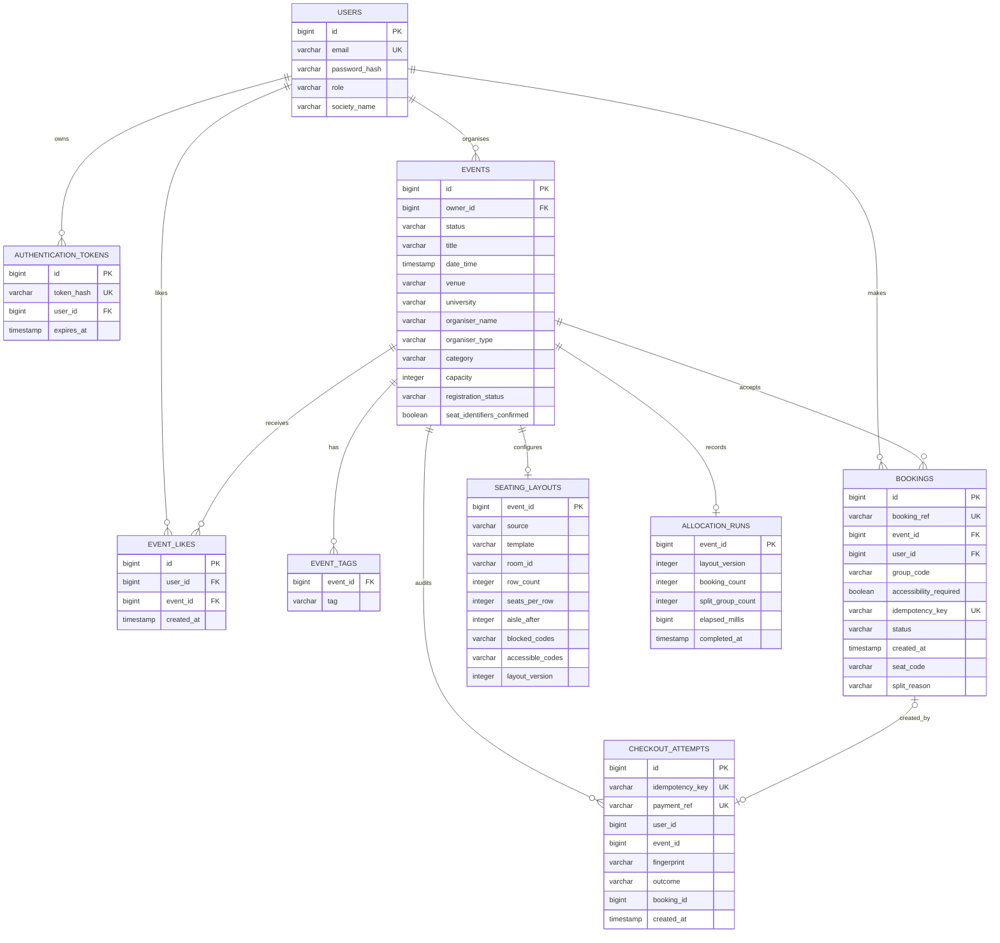

# Tixora database model (Sprint 3)

`EVENT_LIKES` also has a unique constraint on `(user_id, event_id)`. `BOOKINGS` has a unique constraint on `(event_id, seat_code)` to prevent duplicate seat assignments. Group codes are resolved within an event; there is no separate group table. `CHECKOUT_ATTEMPTS` stores scalar user, event and booking IDs, and `SEATING_LAYOUTS` and `ALLOCATION_RUNS` use the event ID as their primary key; their diagram links express the application relationship, not database foreign-key constraints. Historical bookings may have no checkout attempt.
