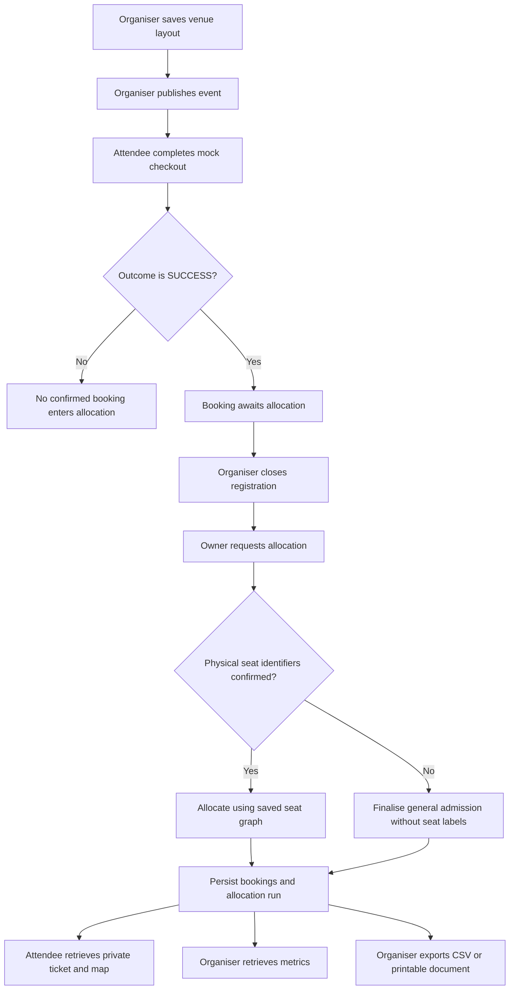
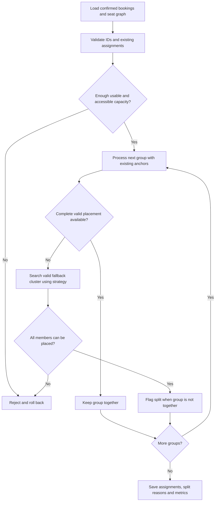
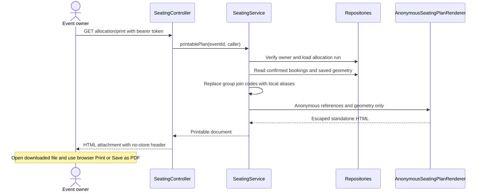

# Seat allocation and outputs backend (FR-17–20)

**Owner:** Rafly Muhammad Ghifari — Member 5, Backend  
**Scope:** allocation, group splits, private ticket/map data, metrics and anonymous exports.

The requirements come from the Proposal's functional-requirements table (page 5), allocation method (pages 8–9) and responsibility table (page 16). The Proposal and Sprint 3 responsibility plan are in the shared `../guidance/` directory, relative to the project root; they are not stored inside this repository.

## 1. Requirements and implementation map

| Requirement | Proposal requirement | Backend implementation | Main verification |
| --- | --- | --- | --- |
| **FR-17** | Assign each confirmed booking to at most one seat. | Filter confirmed bookings, lock the event, validate constraints, persist assignments and one allocation run atomically. | `SeatAllocationServiceTest`, `SeatingIntegrationTest`, `GeneralAdmissionPersistenceTest` |
| **FR-18** | Keep groups contiguous where feasible and flag splits. | Group-aware deterministic allocation, table/row topology, split reasons and selectable split-placement strategy. | `SeatAllocationServiceTest`, `TableAllocationTest`, `AllocationEvaluationTest`, `SeatingIntegrationTest` |
| **FR-19** | Publish an assigned-seat map and digital ticket after allocation. | Booking-owner ticket endpoint returns the stored seat, split explanation and legacy or managed map. | `SeatingIntegrationTest` |
| **FR-20** | Let the organiser view allocation metrics and export an anonymised seating plan. | Owner-only metrics, existing CSV export and new backend-generated printable HTML export. | `SeatingIntegrationTest`, `PrintableSeatingPlanIntegrationTest`, `AnonymousSeatingPlanRendererTest` |

The allocator, persistence and ticket APIs already existed. The recent backend changes add `elapsedMillis` to the metrics response and introduce the printable-document endpoint and renderer. They do not add application pages, frontend routes, JSX changes, database migrations or dependencies. The existing dashboard has not been updated to select a metrics event or display the additional fields; frontend presentation remains separate integration work.

## 2. Complete backend journey



**Confirmed** means an active, non-cancelled booking linked to a recorded `SUCCESS` checkout attempt. `PENDING_ALLOCATION` describes a confirmed booking awaiting allocation; it does not describe an unconfirmed payment. Declined/cancelled attempts and legacy bookings without a recorded successful attempt do not enter a new allocation run.

## 3. FR-17 — One assignment per confirmed booking

### Request and preconditions

```http
POST /api/organiser/events/{eventId}/allocate
Authorization: Bearer <organiser-token>
```

- The caller must have the `COMMITTEE_MEMBER` role and own the event.
- Registration or the event must be closed before allocation.
- A new run requires at least one confirmed booking.
- Assigned seating requires confirmed physical identifiers and a saved, usable layout.
- Without confirmed physical identifiers, the service finalises general admission with null seat codes.

### Processing and guarantees

`SeatingService.allocate` runs in a transaction at `READ_COMMITTED` isolation and obtains a write lock on the event. It loads confirmed bookings and converts the saved layout into allocation inputs. Managed maps and legacy layouts both feed the existing allocator.

The allocator validates unique booking/seat IDs, available capacity, blocked positions and accessible-seat requirements. For managed maps, existing valid assignments are preserved; reserved and private positions are handled before allocating remaining bookings. A database unique constraint on `(event_id, seat_code)` provides a second defence against duplicate assigned seats.

On success, the service saves booking assignments, split reasons and the event's `AllocationRun`. A feasible assigned-seating run must leave every confirmed input booking assigned exactly once. If a hard constraint cannot be met, the transaction fails without committing a partial run. General admission deliberately has no physical seat assignment, even though its finalised booking status is `ALLOCATED`.

### Safe retries

A repeated allocation request returns the saved run instead of reshuffling seats. Omitting `strategy` accepts that run's recorded strategy. Explicitly requesting a different strategy after completion returns `409 Conflict`; allocation is final for that layout. Separate owner-authorised managed-seat moves use the existing seating-management API, not a new allocation run.

## 4. FR-18 — Groups, contiguity and split explanations

A contiguous row block consists of consecutive seat numbers within the same element, section, row index and row label. Gaps, aisles and element boundaries break a block. A group sharing one table also counts as **together**, including members on different table sides.

The allocator processes larger groups first, seeks a complete valid placement, and preserves accessible capacity needed by remaining attendees. Existing managed assignments act as fixed anchors. Deterministic ordering resolves equivalent candidates consistently.



### Strategies

| Strategy | Behaviour |
| --- | --- |
| `DEFAULT` | Tries to keep the full group together; fallback placement balances subgroup sizes while penalising additional placement units. |
| `PREFER_SAME_ROW` | Tries to keep the full group together; fallback favours one physical row where feasible, otherwise fewer placement units and balanced contiguous subgroups. |

A placement unit is a theatre row or a table. Both strategies enforce the same capacity, accessibility, fixed-assignment and blocked-seat constraints. Neither preference overrides a hard constraint.

```http
POST /api/organiser/events/{eventId}/allocate?strategy=PREFER_SAME_ROW
Authorization: Bearer <organiser-token>
```

The default strategy is used when the parameter is omitted on a new run. The two strategies affect fallback placement, not the definition of a valid seat or a group kept together.

### Split reporting

The service stores a `splitReason` on affected bookings and records the number of split groups. Tickets and exports expose the explanation. For example:

> No single table or contiguous valid block was available while preserving existing assignments; nearest valid seats were used

This is a deterministic heuristic, not a global optimisation proof. A split reports the placement found under the current constraints and earlier placements; it does not prove that every alternative ordering would split the group. Managed-map processing can refresh the reason to reflect current assignments.

## 5. FR-19 — Private digital ticket and assigned-seat map

```http
GET /api/bookings/{bookingId}/ticket
Authorization: Bearer <booking-owner-token>
```

Only the booking owner can retrieve this response. A missing booking or another attendee's booking returns `404`, rather than revealing its private details. Event-owner status alone does not grant access to someone else's private ticket through this endpoint.

| Field | Meaning |
| --- | --- |
| `booking` | The caller's booking reference, event, private group code, accessibility request and status. |
| `eventDate`, `venue` | Event information used by the ticket. |
| `paymentStatus` | `MOCK_SUCCESS` when a successful attempt exists; otherwise `UNVERIFIED_LEGACY`. No real payment verification is implied. |
| `seatCode` | Stored physical seat code after assigned seating; null while pending or for general admission. |
| `splitReason` | Stored group-split explanation, or null. |
| `generalAdmission` | Whether the event lacks confirmed physical seat identifiers. |
| `layout` | Legacy layout representation, when present. |
| `managedMap` | Managed-map representation, when present; attendee map output omits organiser booking-assignment identifiers. |

The endpoint can also return pending or unverified legacy bookings. Clients must inspect `booking.status` and `paymentStatus` before presenting a final confirmed ticket. After successful allocation, seated attendees receive their persisted seat; general-admission attendees receive no invented seat label. The endpoint supplies ticket data, not a QR check-in or scanning service.

## 6. FR-20 — Metrics and anonymous seating outputs

### 6.1 Metrics API

```http
GET /api/organiser/events/{eventId}/allocation/metrics
Authorization: Bearer <organiser-token>
```

The caller must own the event and have the organiser role. A saved allocation run is required. The response retains the existing evaluation fields and adds the original run's `elapsedMillis`.

Illustrative response, not a measured benchmark result:

```json
{
  "groupCount": 2,
  "splitGroupCount": 0,
  "percentageGroupsTogether": 100.0,
  "averageSplitDistance": 0.0,
  "averageGroupContiguityPercentage": 100.0,
  "isolatedSeatCount": 2,
  "duplicateAllocationCount": 0,
  "elapsedMillis": 123
}
```

| Field | Definition and interpretation |
| --- | --- |
| `groupCount` | Named groups with at least two confirmed members. Solo attendees and one-member named groups do not enter group metrics. |
| `splitGroupCount` | Evaluated groups that do not occupy one contiguous row block or one table. |
| `percentageGroupsTogether` | `100 × (groupCount - splitGroupCount) / groupCount`; null when no groups are evaluated. |
| `averageSplitDistance` | Sum of distances over all unordered member pairs in split groups, divided by the total number of those pairs. Pair-weighted across split groups, not an unweighted mean of group averages. Zero when there are no split-group pairs. |
| `averageGroupContiguityPercentage` | Unweighted mean of each evaluated group's retained adjacency percentage: `100 × (members - blocks) / (members - 1)`. Null when no groups are evaluated. |
| `isolatedSeatCount` | Empty usable positions whose immediate numbered neighbours are not also free in the same row block, including isolated row ends. Blocked/private positions are excluded. |
| `duplicateAllocationCount` | Excess booking assignments plus excess seat assignments. A valid allocation has zero. |
| `elapsedMillis` | Persisted service timing from the original allocation run, in milliseconds. Reading metrics does not rerun or retime allocation. |

**Distance units:** logical seat/row steps, not metres or SVG coordinates. Pair distance is `1.5 × row steps + seat-number steps`, plus one for a section boundary and one for an element boundary. Different row labels count as at least one row step even when their indices match.

**Together versus contiguity:** three members occupying two separate blocks have `50%` retained contiguity. A table group can count as kept together while retaining less than `100%` physical adjacency across its sides. These fields measure different aspects of the placement.

**General admission:** the six seat/group fields are null, `duplicateAllocationCount` is zero, and `elapsedMillis` remains available. Clients should label null metrics as not applicable rather than showing `null%` or inventing zero percentages.

**Current assignments versus original runtime:** evaluation is calculated from current confirmed bookings and assignments. Owner-authorised managed-seat moves can change those measures. `elapsedMillis` remains the original run's timing. It measures the allocation service through the first flush of the assignments and run; the final runtime-field update and transaction commit occur afterwards. It is not HTTP latency or a production performance guarantee.

### 6.2 Existing CSV export

```http
GET /api/organiser/events/{eventId}/allocation/export
Authorization: Bearer <organiser-token>
```

The owner-only endpoint requires a saved run and returns an attachment named `event-{eventId}-allocation.csv` with these columns:

```csv
booking_reference,group_reference,seat,split_reason
```

Only active, mock-success-confirmed bookings are included. General admission uses `GENERAL_ADMISSION` in the seat column. The CSV contains no attendee names, email addresses, student IDs or card data.

The existing CSV contract retains the stored event group code in `group_reference`. It does **not** use the printable document's local `G1` aliases. Consumers should not treat these two reference formats as interchangeable.

### 6.3 New printable document export

```http
GET /api/organiser/events/{eventId}/allocation/print
Authorization: Bearer <organiser-token>
```

This is a backend-generated downloadable document, not a new application page. The backend reads current confirmed assignments and renders self-contained HTML with inline SVG and print CSS. No frontend rendering or external assets are required to print it.

| Response detail | Value |
| --- | --- |
| Content type | `text/html;charset=UTF-8` |
| Attachment | `event-{eventId}-seating-plan.html` |
| Caching | `Cache-Control: no-store` |
| Content security policy | `default-src 'none'; style-src 'unsafe-inline'; base-uri 'none'; form-action 'none'` |



The document contains:

- Event title, date, venue, layout version and original allocation completion time.
- A schematic overview with seat codes, assignment markers, unavailable positions, accessible outlines and preserved aisle gaps.
- Additional row/table diagrams when the map contains more than 60 positions, so readers need not rely on the scaled overview.
- A table joining plan references such as `P1` to booking references, group aliases, seat codes and split explanations.
- A general-admission explanation and reference table instead of a seat diagram when seats are not assigned.
- A campus-demo notice for legacy demo profiles. All geometry remains schematic; an export does not establish physical venue verification.

Only active bookings linked to successful mock checkout are exported. Free-form map notes, attendee records, organiser booking-assignment IDs and private group join codes are not passed to the renderer. Text fields are HTML-escaped, including text embedded in SVG. Group aliases such as `G1` exist only within the generated document and cannot be used to join a group; regenerate the document after assignment changes.

Open the downloaded HTML in a browser, then choose **Print** or **Save as PDF**. The server returns HTML, not a PDF. Print CSS uses A4 margins, hides usage instructions, keeps assignment rows together and repeats table headers. Paper copies or downloaded files are snapshots; later seat moves do not update them automatically.

### 6.4 API walkthrough

Run from the project root. Substitute an existing event ID and authenticated tokens; no real credentials are included below. The example assumes checkout has already produced confirmed bookings and that the layout was saved before publication.

```bash
API_BASE='http://localhost:8080'
EVENT_ID='42'
BOOKING_ID='123'
ORGANISER_TOKEN='<event-owner-token>'
ATTENDEE_TOKEN='<booking-owner-token>'

# Close registration using the existing event lifecycle API.
curl --fail-with-body -X PATCH "$API_BASE/api/events/$EVENT_ID/status" \
  -H "Authorization: Bearer $ORGANISER_TOKEN" \
  -H 'Content-Type: application/json' \
  -d '{"status":"closed"}'

# Allocate once; an identical retry returns the saved run.
curl --fail-with-body -X POST "$API_BASE/api/organiser/events/$EVENT_ID/allocate" \
  -H "Authorization: Bearer $ORGANISER_TOKEN"

curl --fail-with-body "$API_BASE/api/organiser/events/$EVENT_ID/allocation/metrics" \
  -H "Authorization: Bearer $ORGANISER_TOKEN"

curl --fail-with-body "$API_BASE/api/bookings/$BOOKING_ID/ticket" \
  -H "Authorization: Bearer $ATTENDEE_TOKEN"

curl --fail-with-body "$API_BASE/api/organiser/events/$EVENT_ID/allocation/export" \
  -H "Authorization: Bearer $ORGANISER_TOKEN" \
  -o event-allocation.csv

curl --fail-with-body "$API_BASE/api/organiser/events/$EVENT_ID/allocation/print" \
  -H "Authorization: Bearer $ORGANISER_TOKEN" \
  -o event-seating-plan.html
```

The last two commands create local output files. Open `event-seating-plan.html` manually to print it. Browser consumers must attach the bearer token when downloading; navigating directly to the API URL without authentication is insufficient.

## 7. Errors and operational limits

| Status | Relevant cases |
| --- | --- |
| `400` | Invalid allocation-strategy parameter or invalid layout input. |
| `401` | Missing, invalid or expired authentication. |
| `403` | Authenticated caller lacks the organiser role or does not own the event. |
| `404` | Event not found; ticket missing or not owned by the caller. |
| `409` | Registration still open; no confirmed bookings for a new run; infeasible allocation; missing required layout; attempt to change an existing run's strategy; metrics/export requested before allocation. |

The proposal's performance target is allocation of feasible datasets with up to 300 confirmed attendees within ten seconds in the documented demonstration environment. A returned runtime is evidence for that run, not proof that every layout/environment meets the target. `AllocationBenchmarkTest` covers varied layouts and group sizes and checks assignments after a persistence-context reload. Its flush/reload checks do not demonstrate application restart, physical venue accuracy or production load behaviour.

## 8. Verification and source files

### Test coverage

| Test class | Relevant coverage |
| --- | --- |
| `SeatAllocationServiceTest` | Deterministic allocation, valid groups, constraints and failure cases. |
| `TableAllocationTest` | Table-aware togetherness and placement. |
| `AllocationEvaluationTest` | Metric definitions, adjacency, split distance and duplicate evaluation. |
| `SeatingIntegrationTest` | Persisted assignments, replay behaviour, ticket privacy, managed-map integration and metrics/runtime API. |
| `GeneralAdmissionPersistenceTest` | Committed general-admission booking/allocation retrieval across transactions. |
| `PrintableSeatingPlanIntegrationTest` | All three legacy template families, managed geometry, general admission, owner access, pre-allocation rejection, anonymous references and escaped event text. |
| `AnonymousSeatingPlanRendererTest` | Escaping of HTML/SVG text and a 300-position document with row details and 280 assignment references. |
| `AllocationBenchmarkTest` | Timed allocation/flush across varied supported layouts, strategies and group sizes, with correctness checks. |

Run the feature checks from the `app` directory:

```bash
cd app
./mvnw -Dtest=SeatingIntegrationTest,PrintableSeatingPlanIntegrationTest,AnonymousSeatingPlanRendererTest test
```

The test profile uses a dedicated MySQL database, defaulting to `eventticketingsystemtest` on localhost:3306, and recreates its tables with `create-drop`. Use a test database, not the development database. Override connection details with `TEST_DB_URL`, `TEST_DB_USERNAME` and `TEST_DB_PASSWORD` as needed. Benchmark tests can be run separately with `./mvnw -Dtest=AllocationBenchmarkTest test`.

During implementation on 25 October 2026, the seating/print integration run passed 74 tests and the renderer run passed 2 tests. A separate browser check verified a synthetic 300-position HTML document, 280 assignment rows, 15 detail diagrams and printed output containing the final booking reference. These are recorded checks from that implementation session, not a new full-suite or performance benchmark run performed for this documentation.

### Source map

Paths below are relative to this document.

- [SeatingController](../app/src/main/java/com/ooaf/eventticketing/controller/SeatingController.java): HTTP endpoints, downloadable response headers and caller identity.
- [SeatingService](../app/src/main/java/com/ooaf/eventticketing/service/SeatingService.java): ownership, transactions, confirmed-booking selection, allocation persistence, tickets, metrics and exports.
- [SeatAllocationService](../app/src/main/java/com/ooaf/eventticketing/allocation/SeatAllocationService.java): group placement and fallback strategies.
- [AllocationTopology](../app/src/main/java/com/ooaf/eventticketing/allocation/AllocationTopology.java): blocks, tables, adjacency and isolated seats.
- [AllocationEvaluation](../app/src/main/java/com/ooaf/eventticketing/allocation/AllocationEvaluation.java): metric calculation.
- [AllocationSeat](../app/src/main/java/com/ooaf/eventticketing/allocation/AllocationSeat.java): logical distance rules.
- [AllocationMetricsResponse](../app/src/main/java/com/ooaf/eventticketing/dto/AllocationMetricsResponse.java): metrics JSON contract, including runtime.
- [AllocationRun](../app/src/main/java/com/ooaf/eventticketing/entity/AllocationRun.java): persisted run identity, strategy, metrics and timing.
- [AnonymousSeatingPlanRenderer](../app/src/main/java/com/ooaf/eventticketing/service/AnonymousSeatingPlanRenderer.java): standalone escaped HTML, SVG diagrams and print styling.
